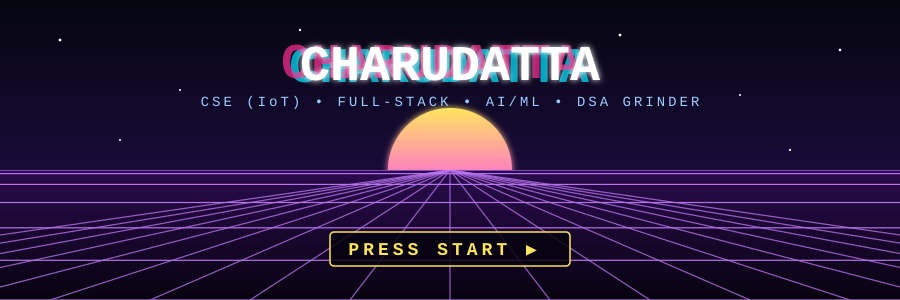

 

<h2>Hey there 👋 I'm Charudatta</h2>

<strong>Computer Science Engineering Student · Full-Stack Developer · AI/ML Enthusiast</strong>

---

## 🔗 Know About Me

<table>
<tr>
<td width="28%" align="center" valign="middle">

  
<strong>CHARUDATTA LENDE</strong>
 
Developer · Learner · Builder
</td>
<td valign="top">

Hey! I'm Charudatta, a Computer Science Engineering student who enjoys turning ideas into useful software.

- 💻 Building full-stack applications with a focus on backend development.
- ⚙️ Exploring REST APIs, databases, backend architecture and scalable systems.
- 🧠 Learning and experimenting with AI/ML, LLMs and AI agents.
- 🧩 Practicing Data Structures & Algorithms in Java.
- 🤝 Outreach Head at Codeware Coding Club.
- 🎯 Preparing for software engineering opportunities and exploring higher studies abroad.

</td>
</tr>
</table>

### ⚙️ Tech Stack

**Languages**

**Frontend & Backend**

**Databases & AI/ML**

**Tools**

---

## 🔗 Top Projects

| Project | What it does |
|---|---|
| [**DocSchedule AI**](https://github.com/CharudattaLende/docschedule-ai) | AI-powered doctor appointment booking assistant built with n8n, Telegram, Google Gemini and Google Sheets. |
| [**Real-Time Chat App**](https://github.com/CharudattaLende/chat-app) | Real-time messaging app with authentication, image sharing and Firebase. |
| [**Campus Complaint & Maintenance Tracker**](https://github.com/CharudattaLende/Collge-MaintaincCampus-Complaint-Maintenance-Tracker) | Full-stack campus complaint management system with Node.js, Express and a MySQL database. |
| [**Spam Email Classifier**](https://github.com/CharudattaLende/spam-email-classifier) | Machine learning project for classifying messages as spam or legitimate. |
| [**Portfolio Website**](https://charudattaportfolio.vercel.app/) | Personal portfolio showcasing my work, skills and developer journey. |

---

## 🔗 Connect

> "Great software isn't built in a day. It's built through curiosity, consistency, and countless iterations."

---

## 🔗 Contribution

---

**Thanks for stopping by! 👋**

*Code · Build · Learn · Repeat*

