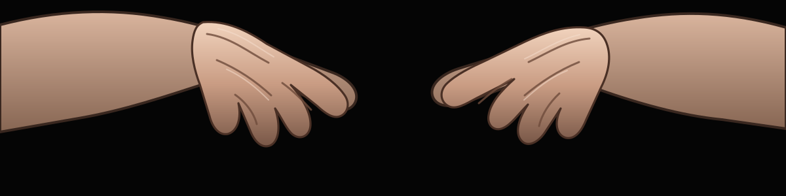
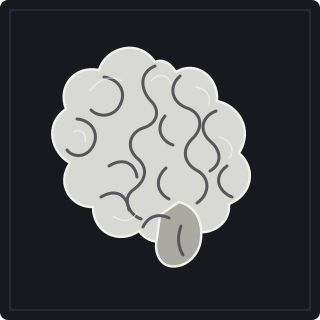
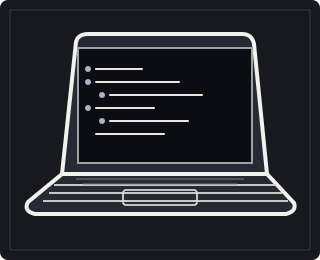

<h2>Hey there 👋 I'm Charudatta</h2>

<strong>Computer Science Engineering Student · Full-Stack Developer · AI/ML Enthusiast</strong>

---

## 🔗 Know About Me

<table width="100%">
<tr>
<td width="170" align="center" valign="top">
 

  
<strong>CHARUDATTA LENDE</strong>
 
Developer · Learner · Builder
</td>
<td valign="top">

Hey there! I'm Charudatta, a Computer Science Engineering student interested in software development and intelligent systems.

I enjoy building practical applications, understanding how systems work behind the scenes, and turning ideas into useful products.

- 💻 Building full-stack applications with a strong focus on backend development.
- ⚙️ Exploring REST APIs, databases, backend architecture and scalable systems.
- 🧠 Learning and experimenting with AI/ML, LLMs and AI agents.
- 🧩 Practicing Data Structures & Algorithms in Java.
- 🤝 Outreach Head at Codeware Coding Club.

**⚙️ Tech Stack**

**Languages**

  

**Development**

   

**Databases & AI/ML**

   

**Tools**

   

</td>
</tr>
</table>

---

## 🔗 Top Projects

<table width="100%">
<tr>
<td valign="top">

- **[DocSchedule AI](https://github.com/CharudattaLende/docschedule-ai)** — AI-powered doctor appointment booking automation using n8n, Telegram, Gemini AI and Google Sheets.

- **[Real-Time Chat App](https://github.com/CharudattaLende/chat-app)** — A real-time messaging application. Explore the repository for implementation details.

- **[Campus Complaint & Maintenance Tracker](https://github.com/CharudattaLende/Collge-MaintaincCampus-Complaint-Maintenance-Tracker)** — A campus-focused complaint and maintenance tracking project.

- **[Spam Email Classifier](https://github.com/CharudattaLende/spam-email-classifier)** — A machine learning project that classifies messages as spam or not spam.

- **[Portfolio Website](https://charudattaportfolio.vercel.app/)** — My personal portfolio showcasing projects, skills and development journey.

</td>
<td width="160" align="center" valign="middle">

</td>
</tr>
</table>

---

## 🔗 Connect

> "Code is never finished. It only becomes a little better with every iteration."

---

## 🔗 Contribution

 

<a href="https://github.com/CharudattaLende?tab=overview&from=2026-01-01&to=2026-12-31">View my GitHub contribution activity</a>

---

**Thanks for visiting my profile! 👋**

*Code · Build · Learn · Repeat*

